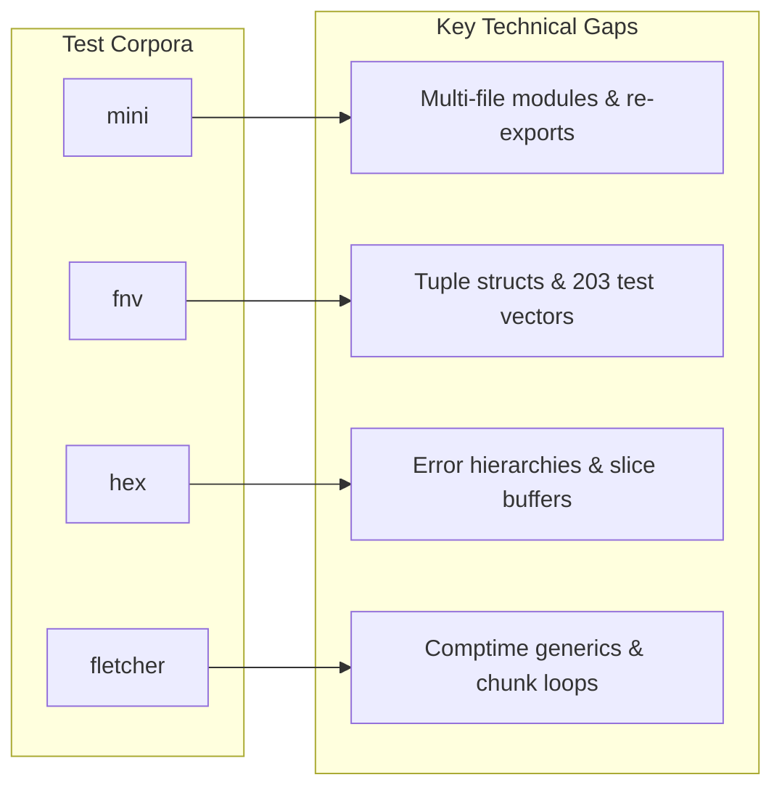
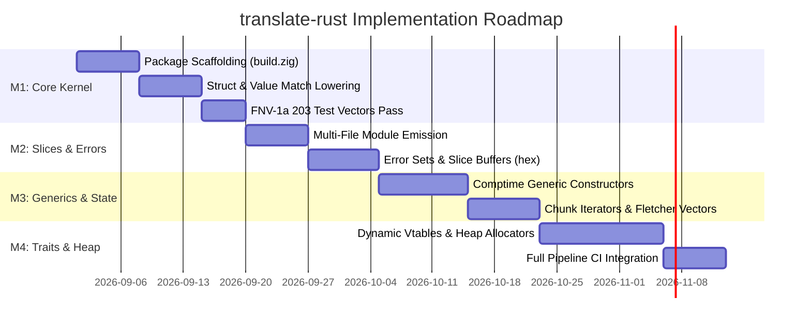

# Feature Translation Mechanics & Actionable Milestone Roadmap

- **Document Path**: `notes/design/architecture/features-actionable.md`
- **Target Version**: Zig 0.16.0
- **Primary References**: `notes/research/idiom-mapping.md`, `notes/research/approaches.md`, `notes/design/data-model/items-types.md`, `notes/design/data-model/exprs-patterns.md`, `notes/design/data-model/ownership-mem.md`, `notes/design/data-model/crate-graph.md`

---

## 1. Executive Summary

This specification defines the semantic lowering mechanics from Rust language features to idiomatic, safe Zig 0.16 (Tiger Style). It provides concrete compilation patterns for non-trivial Rust constructs (enums, error handling, pattern matching, unsafe pointers, concurrency) and establishes a gap analysis and milestone roadmap for our four test corpora: `mini`, `fnv`, `hex`, and `fletcher`.

---

## 2. Advanced Rust Feature Translation Mechanics

### 2.1 Enums and Tagged Unions

Rust enums represent both fieldless enumerations (C-style) and sum types with data payloads (tagged unions). In Zig 0.16, fieldless enums map to `enum(uN)`, while data-carrying enums map to `union(enum)`.

```mermaid
flowchart TD
    A[Rust Enum] --> B{Has Variant Payloads?}
    B -->|No| C[Fieldless enum: `enum uN`]
    B -->|Yes| D[Tagged Union: `union enum`]
    D --> E{Recursive via Box?}
    E -->|Yes| F[Node Pointer: `*Self` + Allocator Lifecycle]
    E -->|No| G[Inline Value Payloads]
    A --> H{`#[non_exhaustive]`?}
    H -->|Yes| I[Lower Switch with Synthetic Fallback Arm]
    H -->|No| J[Standard Exhaustive Switch]
```

#### 2.1.1 Fieldless (C-Like) Enums
Fieldless enums lower directly to Zig enums with an explicit integer backing type. If `#[repr(uN)]` is specified, the backing integer type is preserved; otherwise, the minimal unsigned integer type (`u8`, `u16`, `u32`) is chosen.

```rust
// Rust
#[repr(u8)]
pub enum HttpMethod {
    Get = 0,
    Post = 1,
    Put = 2,
    Delete = 3,
}
```

```zig
// Zig 0.16
pub const HttpMethod = enum(u8) {
    Get = 0,
    Post = 1,
    Put = 2,
    Delete = 3,

    pub fn toInt(self: HttpMethod) u8 {
        return @intFromEnum(self);
    }

    pub fn fromInt(val: u8) ?HttpMethod {
        return std.enums.fromInt(HttpMethod, val);
    }
};
```

#### 2.1.2 Data-Carrying Enums with Payloads
Variants containing tuple fields or struct fields lower to variants of a `union(enum)`.

```rust
// Rust
pub enum Shape {
    Circle(f64),
    Rect { width: f64, height: f64 },
    Point,
}
```

```zig
// Zig 0.16
pub const Shape = union(enum) {
    Circle: f64,
    Rect: struct {
        width: f64,
        height: f64,
    },
    Point: void,

    pub fn area(self: Shape) f64 {
        switch (self) {
            .Circle => |r| return r * r * 3.141592653589793,
            .Rect => |rect| return rect.width * rect.height,
            .Point => return 0.0,
        }
    }
};
```

#### 2.1.3 Recursive Variants via Indirection
Recursive enum types in Rust use `Box<T>` to break infinite sizing. In Zig, self-referential types cannot be stored by value. They must lower to explicit single-item pointers (`*Self` or `?*Self`) with explicit allocator management.

```rust
// Rust
pub enum IntList {
    Cons(i32, Box<IntList>),
    Nil,
}
```

```zig
// Zig 0.16
pub const IntList = union(enum) {
    Cons: struct {
        head: i32,
        tail: *IntList,
    },
    Nil: void,

    pub fn deinit(self: *IntList, allocator: std.mem.Allocator) void {
        switch (self.*) {
            .Cons => |cons| {
                cons.tail.deinit(allocator);
                allocator.destroy(cons.tail);
            },
            .Nil => {},
        }
    }
};
```

#### 2.1.4 `#[non_exhaustive]` Attribute
Rust's `#[non_exhaustive]` prevents downstream crates from writing exhaustive matches without a wildcard `_`. In Zig, `switch` on an enum or tagged union is strictly exhaustive. For non-exhaustive enums, the transpiler generates switch lowering with an explicit `else` prong or adds a hidden tag.

---

### 2.2 Error Handling and Results

Rust unifies fallibility under `Result<T, E>`. Zig provides native error unions (`E!T`) for finite error sets, but does not allow arbitrary data payloads in error sets.

```mermaid
flowchart LR
    R[Rust `Result<T, E>`] --> Check{Does E have payload fields?}
    Check -->|No payload: error code enum| EU[Zig Error Union: `E!T`]
    Check -->|Has payload: struct/rich enum| TU[Zig Tagged Union: `union enum { ok: T, err: E }`]
    EU --> O1[`?` lowers to `try expr`]
    TU --> O2[`?` lowers to unwrap switch]
```

#### 2.2.1 Finite Error Code Enums -> Zig Error Sets
When `E` has no variant payloads, `E` translates to a Zig `error` set and `Result<T, E>` translates to an error union `E!T`.

```rust
// Rust
#[derive(Debug, PartialEq)]
pub enum DecodeError {
    InvalidChar,
    OddLength,
}

pub fn check_length(len: usize) -> Result<(), DecodeError> {
    if len % 2 != 0 {
        return Err(DecodeError::OddLength);
    }
    Ok(())
}
```

```zig
// Zig 0.16
pub const DecodeError = error{
    InvalidChar,
    OddLength,
};

pub fn check_length(len: usize) DecodeError!void {
    if (len % 2 != 0) {
        return error.OddLength;
    }
}
```

#### 2.2.2 Rich Payload Errors -> Tagged Union Fallback
When `E` carries diagnostic fields (such as `FromHexError::InvalidHexCharacter { c: char, index: usize }`), `Result<T, E>` lowers to a generic tagged union container.

```zig
// Zig 0.16
pub fn Result(comptime T: type, comptime E: type) type {
    return union(enum) {
        ok: T,
        err: E,

        pub fn isOk(self: @This()) bool {
            return self == .ok;
        }

        pub fn unwrap(self: @This()) T {
            switch (self) {
                .ok => |val| return val,
                .err => std.debug.panic("attempted to unwrap error result", .{}),
            }
        }
    };
}
```

#### 2.2.3 The `?` Operator Lowering
- For Zig error unions: `expr?` -> `try expr`.
- For Tagged Union Results:
  ```zig
  // Lowering `let val = expr?;`
  const val = switch (expr) {
      .ok => |v| v,
      .err => |e| return .{ .err = e },
  };
  ```

#### 2.2.4 Conversion Functions
- `res.unwrap()` / `opt.unwrap()` -> `res catch unreachable` (or `opt orelse unreachable`).
- `res.expect("msg")` -> `res catch |err| std.debug.panic("{s}: {s}", .{ "msg", @errorName(err) })`.

---

### 2.3 Pattern Matching and Control Flow

Rust's pattern matching includes scalar constants, enum payloads, tuples, struct fields, guards (`if guard`), and ranges (`1..=5`).

#### 2.3.1 Multi-Arm Match Lowering
Exhaustive scalar and enum matches lower directly to Zig `switch`.

```rust
// Rust
pub fn classify_byte(b: u8) -> u32 {
    match b {
        0 => 0,
        1..=9 => 1,
        b'a'..=b'f' | b'A'..=b'F' => 2,
        _ => 3,
    }
}
```

```zig
// Zig 0.16
pub fn classify_byte(b: u8) u32 {
    return switch (b) {
        0 => 0,
        1...9 => 1,
        'a'...'f', 'A'...'F' => 2,
        else => 3,
    };
}
```

#### 2.3.2 Match Guards and Complex Destructuring
Zig `switch` prongs do not allow runtime expressions. When match guards (`if condition`) are present, the match statement compiles into an `if / else if` decision tree or a switch with fallthrough re-dispatch.

```rust
// Rust
pub fn evaluate_pair(pair: (i32, i32)) -> i32 {
    match pair {
        (x, y) if x == y => x * 2,
        (x, y) if x > y => x - y,
        (_, y) => y,
    }
}
```

```zig
// Zig 0.16
pub fn evaluate_pair(pair: struct { @"0": i32, @"1": i32 }) i32 {
    const x = pair.@"0";
    const y = pair.@"1";
    if (x == y) {
        return x *% 2;
    } else if (x > y) {
        return x -% y;
    } else {
        return y;
    }
}
```

#### 2.3.3 `if let` and `let else`
- `if let Some(x) = opt { ... } else { ... }` -> `if (opt) |x| { ... } else { ... }`.
- `let Some(x) = opt else { return; };` -> `const x = opt orelse return;`.

---

### 2.4 Unsafe Code and Raw Pointers

Rust distinguishes between safe references (`&T`, `&mut T`) and raw pointers (`*const T`, `*mut T`).

```mermaid
flowchart TD
    P[Rust Pointer / Reference] --> K{Kind}
    K -->|Single Item `&T`| S1[`*const T`]
    K -->|Single Item `&mut T`| S2[`*T`]
    K -->|Array / Buffer `*const T`| M1[`[*]const T`]
    K -->|Array / Buffer `*mut T`| M2[`[*]T`]
    K -->|Nullable Raw Pointer| N1[`?[*]const T` / `?*T`]
```

#### 2.4.1 Pointer Type Mapping
- Single-item immutable pointer: `*const T`.
- Single-item mutable pointer: `*T`.
- Many-item pointer (unknown length array): `[*]const T` or `[*]T`.
- Nullable raw pointer: `?*const T` or `?[*]T`.
- Slices (`&[T]`, `&mut [T]`): `[]const T` and `[]T`.

#### 2.4.2 Pointer Arithmetic and Slicing
Rust `ptr.add(offset)` and `ptr.offset(offset)` map to Zig pointer arithmetic on many-item pointers:
```zig
// Zig 0.16
const item_ptr = base_many_ptr + offset;
```

#### 2.4.3 Type and Alignment Casting
- `@ptrCast`: Performs byte-level pointer type reinterpretation.
- `@alignCast`: Asserts that a pointer satisfies the alignment of the target type.
- Tiger Style safety requirement: Assert preconditions before casting.

```zig
// Zig 0.16 Tiger Style Pointer Transmutation
pub fn readU32Le(bytes: []const u8) u32 {
    std.debug.assert(bytes.len >= 4);
    const ptr: *const [4]u8 = @ptrCast(bytes.ptr);
    return std.mem.readInt(u32, ptr, .little);
}
```

---

### 2.5 Concurrency and Async Lowering

#### 2.5.1 Zig 0.16 Concurrency Model
Zig 0.16 removed language-level `async`/`await` keywords. Asynchronous operations in Zig 0.16 use the **`std.Io`** interface — an explicit, ambient I/O capability passed to functions (similar to `std.mem.Allocator`).

#### 2.5.2 Translation Strategy
1. **Strategy 1: Synchronous Baseline (v1/v2 Default)**:
   For pure computation and no_std crates, Rust `async fn` is lowered to synchronous functions executing to completion.
2. **Strategy 2: `std.Io` Capability Injection**:
   For I/O-bound crates, asynchronous functions accept `io: std.Io` explicitly:
   ```zig
   // Zig 0.16 Async I/O Pattern
   pub fn fetchPayload(io: std.Io, socket: std.net.Stream, buffer: []u8) !usize {
       return socket.read(io, buffer);
   }
   ```

---

## 3. Actionable Gap Analysis for Test Crates



---

### 3.1 `mini` (`test/crates/mini`)

#### 3.1.1 Target Rust Surface
- `src/lib.rs` and `src/util.rs`.
- `pub mod util;` with `pub use util::helper;`.
- `pub struct Point { pub x: i32, pub y: i32 }`.
- `pub enum Shape { Circle(f64), Rect { width: f64, height: f64 } }`.
- `pub fn area(shape: Shape) -> f64` with `match`.
- `pub fn origin() -> Point`.

#### 3.1.2 Concrete Technical Gaps
1. **Multi-File Emission**: Emitter must generate `util.zig` and import it into `lib.zig` via `pub const util = @import("util.zig");`.
2. **Re-Export Synthesis**: Translate `pub use util::helper;` to `pub const helper = util.helper;`.
3. **Struct Field Emission**: Emit `Point` as `pub const Point = struct { x: i32, y: i32 };`.
4. **Tagged Union Emission**: Emit `Shape` as `pub const Shape = union(enum) { Circle: f64, Rect: struct { width: f64, height: f64 } };`.
5. **Pattern Match Lowering**: Lower `match shape` to `switch (shape) { .Circle => |r| ..., .Rect => |rect| ... }`.

#### 3.1.3 Golden Output Specification (`mini.zig` & `util.zig`)
```zig
// util.zig
pub fn helper(v: u8) u8 {
    return v +% 1;
}

// lib.zig
pub const util = @import("util.zig");
pub const helper = util.helper;

pub const Point = struct {
    x: i32,
    y: i32,
};

pub const Shape = union(enum) {
    Circle: f64,
    Rect: struct {
        width: f64,
        height: f64,
    },
};

pub fn area(shape: Shape) f64 {
    return switch (shape) {
        .Circle => |r| r * r * 3.14159,
        .Rect => |rect| rect.width * rect.height,
    };
}

pub fn origin() Point {
    return Point{ .x = 0, .y = 0 };
}
```

---

### 3.2 `fnv` (`test/crates/fnv`)

#### 3.2.1 Target Rust Surface
- `pub struct FnvHasher(u64);`.
- `impl Default for FnvHasher` (`default() -> FnvHasher` with initial constant `0xcbf29ce484222325`).
- `impl FnvHasher` (`with_key(key: u64)`).
- `impl Hasher for FnvHasher` (`finish(&self) -> u64`, `write(&mut self, bytes: &[u8])`).
- 203 unit test assertions across strings, byte escapes, and repeat helpers.

#### 3.2.2 Concrete Technical Gaps
1. **Package Scaffolding**: Automated generation of `build.zig` and `build.zig.zon` for standalone `r2z-fnv`.
2. **Tuple Struct Lowering**: Translate single-field tuple struct to `pub const FnvHasher = struct { @"0": u64 = 0xcbf29ce484222325, ... };`.
3. **Trait Method Inlining**: Lower `Hasher` trait methods directly into the `FnvHasher` struct namespace.
4. **Wrapping Arithmetic Emission**: Translate `wrapping_mul(0x100000001b3)` to `*% 0x100000001b3`.
5. **Automated Test Harness Generation**: Transpile all 203 test vectors in `lib.rs:140-367` into `test "basic_tests"` blocks executable via `zig test`.

#### 3.2.3 Golden Output Specification (`r2z-fnv/lib.zig`)
```zig
const std = @import("std");

pub const FnvHasher = struct {
    @"0": u64,

    pub const INITIAL_STATE: u64 = 0xcbf29ce484222325;
    pub const PRIME: u64 = 0x100000001b3;

    pub fn default() FnvHasher {
        return FnvHasher{ .@"0" = INITIAL_STATE };
    }

    pub fn with_key(key: u64) FnvHasher {
        return FnvHasher{ .@"0" = key };
    }

    pub fn finish(self: *const FnvHasher) u64 {
        return self.@"0";
    }

    pub fn write(self: *FnvHasher, bytes: []const u8) void {
        var hash = self.@"0";
        for (bytes) |byte| {
            hash = hash ^ @as(u64, byte);
            hash = hash *% PRIME;
        }
        self.@"0" = hash;
    }
};

pub fn fnv1a(bytes: []const u8) u64 {
    var hasher = FnvHasher.default();
    hasher.write(bytes);
    return hasher.finish();
}
```

---

### 3.3 `hex` (`test/crates/hex`)

#### 3.3.1 Target Rust Surface
- `error.rs`: `pub enum FromHexError { InvalidHexCharacter { c: char, index: usize }, OddLength, InvalidStringLength }`.
- `lib.rs`: `encode_to_slice`, `decode_to_slice`, `val(c: u8, idx: usize)`, `byte2hex(byte: u8, table: &[u8; 16])`.

#### 3.3.2 Concrete Technical Gaps
1. **Multi-Module Error Splitting**: Transpile `error.rs` into `error.zig` and link via `pub const FromHexError = @import("error.zig").FromHexError;`.
2. **Rich Error Representation**: Lower `FromHexError` to a tagged union or error union with diagnostic inspection.
3. **Mutable Buffer Slices**: Translate `output: &mut [u8]` to `output: []u8` with bounds checking (`if (output.len < input.len * 2) return error.InvalidStringLength`).
4. **Hex Table Indexing & Tuple Returns**: Translate `byte2hex` returning `(u8, u8)` into struct `{ @"0": u8, @"1": u8 }`.
5. **Loop and Slice Stepping**: Transpile pair-wise hex parsing into standard Zig loops:
   ```zig
   var i: usize = 0;
   while (i < data.len) : (i += 2) {
       const high = try val(data[i], i);
       const low = try val(data[i + 1], i + 1);
       out[i / 2] = (high << 4) | low;
   }
   ```

---

### 3.4 `fletcher` (`test/crates/fletcher`)

#### 3.4.1 Target Rust Surface
- `pub trait FletcherAccumulator: Sized + Copy + ... { type InputType; const MAX_CHUNK_SIZE: usize; ... }`.
- `impl FletcherAccumulator for u16, u32, u64`.
- `pub struct Fletcher<T: FletcherAccumulator> { a: T, b: T }`.
- `impl<T: FletcherAccumulator> Fletcher<T>` (`new`, `update`, `value`, `reduce`, `combine`, `check_values`).
- Type aliases: `Fletcher16 = Fletcher<u16>`, `Fletcher32 = Fletcher<u32>`, `Fletcher64 = Fletcher<u64>`.
- One-shot functions: `calc_fletcher16`, `calc_fletcher32`, `calc_fletcher64`.

#### 3.4.2 Concrete Technical Gaps
1. **Comptime Generic Structs**: Translate `Fletcher<T>` into a comptime type constructor `pub fn Fletcher(comptime T: type) type`.
2. **Trait Constraint Lowering**: Implement trait bounds using comptime struct traits / duck-typing:
   ```zig
   pub fn Fletcher(comptime T: type) type {
       const Traits = switch (T) {
           u16 => struct {
               pub const InputType = u8;
               pub const MAX_CHUNK_SIZE: usize = 20;
               pub const MASK: u16 = 0xff;
           },
           u32 => struct {
               pub const InputType = u16;
               pub const MAX_CHUNK_SIZE: usize = 360;
               pub const MASK: u32 = 0xffff;
           },
           u64 => struct {
               pub const InputType = u32;
               pub const MAX_CHUNK_SIZE: usize = 92680;
               pub const MASK: u64 = 0xffffffff;
           },
           else => @compileError("Unsupported Fletcher accumulator type"),
       };
       return struct {
           a: T,
           b: T,
           // methods...
       };
   }
   ```
3. **Chunking Loop Lowering**: Translate Rust's `data.chunks(MAX_CHUNK_SIZE)` into a stepped slice window `while (offset < data.len)` loop.
4. **Vector Validation**: Automated test translation validating the 6 checksum gold vectors.

---

## 4. Prioritized Implementation Milestone Roadmap



---

### Milestone M1: Standalone Package Scaffolding & Pure Value Structs (`mini`, `fnv`)
- **Objective**: Translate self-contained, zero-dependency crates into standalone, compilable Zig packages.
- **Key Deliverables**:
  1. Automated generation of `build.zig` and `build.zig.zon` from `Cargo.toml`.
  2. Tuple struct lowering and fieldless struct lowering.
  3. Wrapping integer arithmetic operators (`*%`, `+%`, `-%`).
  4. Exhaustive scalar `switch` statement emission.
  5. Translation of `test/crates/fnv` passing all 203 unit tests.
- **Acceptance Criteria**:
  ```bash
  translate-rust test/crates/fnv -o out/fnv
  cd out/fnv && zig build test # Exit code 0, 203 test vectors pass
  ```

---

### Milestone M2: Multi-Module Error Hierarchies & Mutable Slices (`hex`)
- **Objective**: Support multi-file crate architectures, custom error types, and mutable slice buffers.
- **Key Deliverables**:
  1. Recursive multi-file module emitter (`@import("submodule.zig")`).
  2. `pub use` alias generation (`pub const item = submodule.item;`).
  3. Error set definition and error union propagation (`try`).
  4. Mutable buffer slice indexing and bounds checking.
  5. End-to-end translation of `test/crates/hex` (`encode_to_slice`, `decode_to_slice`).
- **Acceptance Criteria**:
  ```bash
  translate-rust test/crates/hex -o out/hex
  cd out/hex && zig build test # Exit code 0, all hex encode/decode tests pass
  ```

---

### Milestone M3: Comptime Generic Constructors & Streaming Accumulators (`fletcher`)
- **Objective**: Enable parametric polymorphism via Zig comptime type functions and slice windowing.
- **Key Deliverables**:
  1. Comptime generic struct emission (`fn Fletcher(comptime T: type) type`).
  2. Comptime duck-typed trait validation and associated constant resolution.
  3. Slice chunking loop lowering (`while (offset < data.len)`).
  4. Type alias definitions (`pub const Fletcher16 = Fletcher(u16);`).
  5. Translation of `test/crates/fletcher` passing all 6 checksum test vectors.
- **Acceptance Criteria**:
  ```bash
  translate-rust test/crates/fletcher -o out/fletcher
  cd out/fletcher && zig build test # Exit code 0, 6 gold vectors pass
  ```

---

### Milestone M4: Dynamic Traits, Allocator Integration & Ecosystem Readiness
- **Objective**: Provide comprehensive heap memory management and dynamic trait dispatch for complex crates.
- **Key Deliverables**:
  1. Explicit `std.mem.Allocator` parameter threading for heap types (`Vec<T>` -> `std.ArrayListUnmanaged(T)`).
  2. Dynamic trait object (`dyn Trait`) translation via synthesized vtables (`struct { ptr: *anyopaque, vtable: *const VTable }`).
  3. Recursive tagged union memory lifecycle helpers (`deinit`).
  4. Safe raw pointer cast generation with `@alignCast` and `@ptrCast` preconditions.
- **Acceptance Criteria**:
  - Heap-allocating crates pass memory leak detection with `std.testing.allocator`.
  - Dynamic trait objects dispatch correctly through generated vtables with zero compile errors.

---

## 5. Architectural Quality Rules (Tiger Style & ASD-STE100)

1. **Explicit Allocation**: No hidden memory allocations. Functions requiring memory accept a `std.mem.Allocator` parameter.
2. **Explicit Integer Operations**: Use wrapping operators (`*%`, `+%`) when matching Rust's `wrapping_*` semantics; use checked arithmetic with explicit assertions otherwise.
3. **Strict Bounds Assertion**: Assert slice lengths and alignments at function entry points (`std.debug.assert(output.len >= input.len * 2)`).
4. **Deterministic Error Sets**: Prefer compile-time error sets over runtime string panics.
