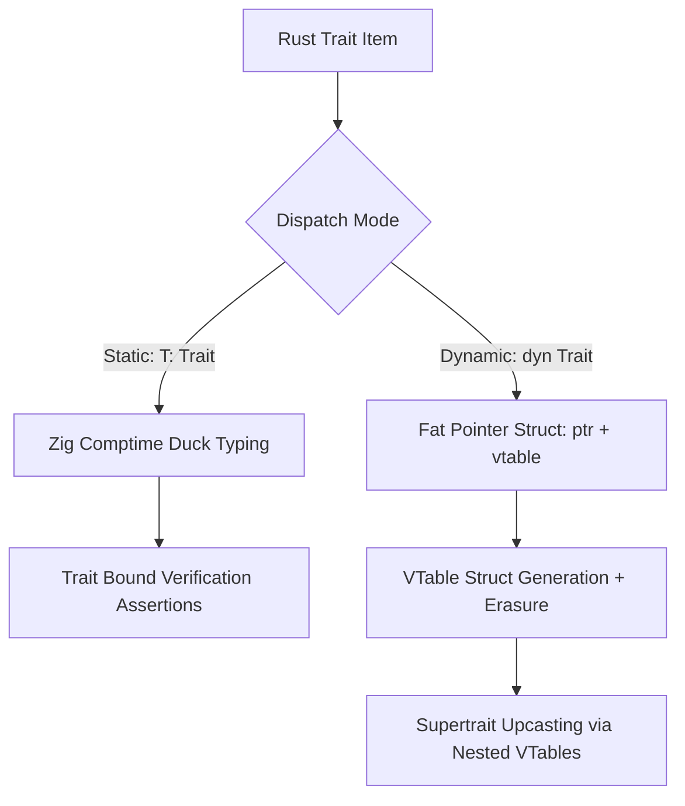

# Runtime & Trait Translation Architecture: `r2z-core` & Trait Systems

This specification defines the runtime support layer (`r2z-core` / `libr2z`) and the trait translation architecture for `translate-rust` targeting **Zig 0.16.0**.

The design follows **Tiger Style** engineering rules: explicit allocators, static memory bounds, deterministic control flow, error unions over hidden exceptions, and zero hidden allocations.

---

## 1. Common Rust Runtime: `r2z-core`

### 1.1 Architectural Precedent
Direct source-to-source transpilation cannot emit pure inline syntax for language-level primitives without unbounded code duplication or compiler-specific intrinsics. Industry precedent demonstrates that a dedicated runtime shim library is mandatory:

- **`c2rust`**: Employs `c2rust-bitfields` and runtime type-cast shims to emulate C layout and pointer semantics.
- **`Cpp2Rust`**: Employs `libcc2rs` to model C++ virtual table layouts, constructors, and stdlib collections.
- **`ccgo`**: Maps C standard library routines to pure Go implementations in `modernc.org/libc`.
- **`Roc` / `Corrosion`**: Standardizes platform and allocator glue through dedicated low-level runtime packages.

`translate-rust` uses `r2z-core` as a modular, zero-overhead Zig library providing polyfills for standard Rust language intrinsics, arithmetic modes, slice iterators, trait protocols, and assertion mechanisms.

### 1.2 Package Distribution and Build Integration
`r2z-core` is distributed as a standard Zig 0.16 package. Every translated crate includes `r2z-core` in its `build.zig.zon`:

```zig
// build.zig.zon of transpiled crate
.{
    .name = .@"r2z-crate-example",
    .version = "0.1.0",
    .fingerprint = 0x8a9b2c3d4e5f6071,
    .minimum_zig_version = "0.16.0",
    .dependencies = .{
        .@"r2z-core" = .{
            .path = "../r2z-core",
        },
    },
    .paths = .{
        "build.zig",
        "build.zig.zon",
        "src",
    },
}
```

In `build.zig`, the dependency module is exposed as `@import("r2z")`:

```zig
// build.zig
const std = @import("std");

pub fn build(b: *std.Build) void {
    const target = b.standardTargetOptions(.{});
    const optimize = b.standardOptimizeOption(.{});

    const r2z_dep = b.dependency("r2z-core", .{
        .target = target,
        .optimize = optimize,
    });
    const r2z_mod = r2z_dep.module("r2z");

    const lib = b.addModule("crate_example", .{
        .root_source_file = b.path("src/lib.zig"),
        .target = target,
        .optimize = optimize,
    });
    lib.addImport("r2z", r2z_mod);
}
```

---

## 2. Core Primitives in `r2z-core`

### 2.1 Checked, Wrapping, and Saturating Arithmetic
Rust integer types feature explicit arithmetic semantics (`wrapping_*`, `saturating_*`, `overflowing_*`, `checked_*`). `r2z-core` exposes these operations with zero abstraction penalty using Zig built-in operators:

```zig
// r2z-core/src/num.zig
const std = @import("std");
const assert = std.debug.assert;

pub fn Wrapping(comptime T: type) type {
    comptime assert(@typeInfo(T) == .int);
    return struct {
        val: T,

        pub inline fn init(val: T) @This() {
            return .{ .val = val };
        }

        pub inline fn add(self: @This(), other: @This()) @This() {
            return .{ .val = self.val +% other.val };
        }

        pub inline fn sub(self: @This(), other: @This()) @This() {
            return .{ .val = self.val -% other.val };
        }

        pub inline fn mul(self: @This(), other: @This()) @This() {
            return .{ .val = self.val *% other.val };
        }
    };
}

pub inline fn saturatingAdd(comptime T: type, a: T, b: T) T {
    const res, const overflow = @addWithOverflow(a, b);
    if (overflow != 0) {
        if (@typeInfo(T).int.signedness == .unsigned) {
            return std.math.maxInt(T);
        } else {
            return if (b > 0) std.math.maxInt(T) else std.math.minInt(T);
        }
    }
    return res;
}

pub inline fn saturatingSub(comptime T: type, a: T, b: T) T {
    const res, const overflow = @subWithOverflow(a, b);
    if (overflow != 0) {
        if (@typeInfo(T).int.signedness == .unsigned) {
            return 0;
        } else {
            return if (b > 0) std.math.minInt(T) else std.math.maxInt(T);
        }
    }
    return res;
}

pub inline fn overflowingAdd(comptime T: type, a: T, b: T) struct { result: T, overflow: bool } {
    const res, const ovf = @addWithOverflow(a, b);
    return .{ .result = res, .overflow = ovf != 0 };
}

pub inline fn rotateLeft(comptime T: type, val: T, shift: u6) T {
    return std.math.rotl(T, val, shift);
}

pub inline fn rotateRight(comptime T: type, val: T, shift: u6) T {
    return std.math.rotr(T, val, shift);
}

pub inline fn leadingZeros(comptime T: type, val: T) u16 {
    return @as(u16, @clz(val));
}

pub inline fn trailingZeros(comptime T: type, val: T) u16 {
    return @as(u16, @ctz(val));
}

pub inline fn swapBytes(comptime T: type, val: T) T {
    return @byteSwap(val);
}
```

### 2.2 Slice Utilities Matching Rust `core::slice`
Rust slice methods enforce safe bounds and cursor management. `r2z-core` implements memory-safe iterators:

```zig
// r2z-core/src/slice.zig
const std = @import("std");
const assert = std.debug.assert;

pub fn Chunks(comptime T: type) type {
    return struct {
        slice: []const T,
        chunk_size: usize,
        index: usize = 0,

        pub fn next(self: *@This()) ?[]const T {
            assert(self.chunk_size > 0);
            if (self.index >= self.slice.len) return null;
            const end = @min(self.index + self.chunk_size, self.slice.len);
            const chunk = self.slice[self.index..end];
            self.index = end;
            return chunk;
        }
    };
}

pub fn Windows(comptime T: type) type {
    return struct {
        slice: []const T,
        window_size: usize,
        index: usize = 0,

        pub fn next(self: *@This()) ?[]const T {
            assert(self.window_size > 0);
            if (self.index + self.window_size > self.slice.len) return null;
            const window = self.slice[self.index .. self.index + self.window_size];
            self.index += 1;
            return window;
        }
    };
}

pub inline fn copyFromSlice(comptime T: type, dst: []T, src: []const T) void {
    assert(dst.len == src.len);
    @memcpy(dst, src);
}
```

### 2.3 Core Trait Runtimes: `Hasher` and `Iterator`
Standard Rust algorithms rely on `core::hash::Hasher` and `core::iter::Iterator`:

```zig
// r2z-core/src/hash.zig
pub const Hasher = struct {
    ptr: *anyopaque,
    vtable: *const VTable,

    pub const VTable = struct {
        finish: *const fn (ctx: *const anyopaque) u64,
        write: *const fn (ctx: *anyopaque, bytes: []const u8) void,
        write_u8: *const fn (ctx: *anyopaque, i: u8) void,
        write_u32: *const fn (ctx: *anyopaque, i: u32) void,
        write_u64: *const fn (ctx: *anyopaque, i: u64) void,
    };

    pub inline fn finish(self: Hasher) u64 {
        return self.vtable.finish(self.ptr);
    }

    pub inline fn write(self: Hasher, bytes: []const u8) void {
        self.vtable.write(self.ptr, bytes);
    }
};

pub const FnvHasher = struct {
    state: u64 = 0xcbf29ce484222325,

    const FNV_PRIME: u64 = 0x100000001b3;

    pub fn write(self: *FnvHasher, bytes: []const u8) void {
        for (bytes) |byte| {
            self.state ^= byte;
            self.state *%= FNV_PRIME;
        }
    }

    pub fn finish(self: *const FnvHasher) u64 {
        return self.state;
    }

    pub fn hasher(self: *FnvHasher) Hasher {
        const gen = struct {
            fn finishErased(ctx: *const anyopaque) u64 {
                const s: *const FnvHasher = @ptrCast(@alignCast(ctx));
                return s.finish();
            }
            fn writeErased(ctx: *anyopaque, bytes: []const u8) void {
                const s: *FnvHasher = @ptrCast(@alignCast(ctx));
                s.write(bytes);
            }
            fn writeU8Erased(ctx: *anyopaque, i: u8) void {
                const s: *FnvHasher = @ptrCast(@alignCast(ctx));
                s.write(&[_]u8{i});
            }
            fn writeU32Erased(ctx: *anyopaque, i: u32) void {
                const s: *FnvHasher = @ptrCast(@alignCast(ctx));
                s.write(&std.mem.toBytes(i));
            }
            fn writeU64Erased(ctx: *anyopaque, i: u64) void {
                const s: *FnvHasher = @ptrCast(@alignCast(ctx));
                s.write(&std.mem.toBytes(i));
            }
            const vtable = Hasher.VTable{
                .finish = finishErased,
                .write = writeErased,
                .write_u8 = writeU8Erased,
                .write_u32 = writeU32Erased,
                .write_u64 = writeU64Erased,
            };
        };
        return .{
            .ptr = self,
            .vtable = &gen.vtable,
        };
    }
};
```

### 2.4 Panic & Assertion Isolation (Preventing Release Regressions)
Rust distinguishes between `assert!` (always active) and `debug_assert!` (active in debug profiles, compiled out in release profiles). 

A critical transpiler defect (observed in historical ports such as early Bun versions) occurs when `debug_assert!(expensive_predicate())` evaluates `expensive_predicate()` in release builds despite discarding the result. `r2z-core` enforces zero evaluation overhead in release modes:

```zig
// r2z-core/src/panic.zig
const std = @import("std");
const builtin = @import("builtin");

pub inline fn panic(comptime msg: []const u8) noreturn {
    @panic(msg);
}

pub inline fn assert(condition: bool) void {
    std.debug.assert(condition);
}

pub inline fn debugAssert(comptime condition_fn: anytype) void {
    if (builtin.mode == .Debug) {
        std.debug.assert(condition_fn());
    }
}
```

In translated code:
- `assert!(x > 0)` translates to `r2z.assert(x > 0);`.
- `debug_assert!(is_valid(tree))` translates to:
  ```zig
  r2z.debugAssert(struct {
      fn check() bool { return isValid(tree); }
  }.check);
  ```

### 2.5 Option & Result Idioms vs Native Zig Syntax
Where possible, simple Rust `Option<T>` maps to Zig `?T` and `Result<T, E>` maps to Zig `E!T`. For non-error `Result<T, E>` types where `E` is an arbitrary struct or value, `r2z-core` provides tagged union wrappers and combinator helpers:

```zig
// r2z-core/src/result.zig
pub fn Result(comptime T: type, comptime E: type) type {
    return union(enum) {
        ok: T,
        err: E,

        pub inline fn isOk(self: @This()) bool {
            return self == .ok;
        }

        pub inline fn isErr(self: @This()) bool {
            return self == .err;
        }

        pub inline fn unwrap(self: @This()) T {
            return switch (self) {
                .ok => |val| val,
                .err => @panic("called `Result.unwrap()` on an `Err` value"),
            };
        }

        pub inline fn unwrapOr(self: @This(), default: T) T {
            return switch (self) {
                .ok => |val| val,
                .err => default,
            };
        }
    };
}
```

---

## 3. Trait Translation: Static vs Dynamic Dispatch

Rust traits serve two distinct roles:
1. **Static Dispatch (Compile-time parametric polymorphism)**: `fn foo<T: Trait>(x: T)` monomorphizes code per type with zero runtime overhead.
2. **Dynamic Dispatch (Trait objects)**: `fn foo(x: &dyn Trait)` invokes methods through a dynamic vtable fat pointer.



### 3.1 Static Dispatch & Comptime Trait Bounds
In Zig, static dispatch uses `comptime T: type` parameters. To guarantee API contract enforcement, `translate-rust` emits trait signature verification checks using comptime reflection:

```zig
// Rust:
// pub trait Summary {
//     fn summarize(&self) []const u8;
// }
// pub fn notify<T: Summary>(item: &T) []const u8 {
//     item.summarize()
// }

// Zig Translation:
pub fn verifySummaryTrait(comptime T: type) void {
    comptime {
        if (!@hasDecl(T, "summarize")) {
            @compileError("Type " ++ @typeName(T) ++ " does not implement required trait method 'summarize'");
        }
        const DeclType = @TypeOf(@field(T, "summarize"));
        const type_info = @typeInfo(DeclType);
        if (type_info != .@"fn") {
            @compileError("'summarize' on type " ++ @typeName(T) ++ " must be a function");
        }
        // Verify function signature: fn(*const T) []const u8
        const params = type_info.@"fn".params;
        if (params.len != 1 or params[0].type.? != *const T) {
            @compileError("'summarize' on " ++ @typeName(T) ++ " must accept (*const " ++ @typeName(T) ++ ")");
        }
    }
}

pub fn notify(comptime T: type, item: *const T) []const u8 {
    comptime verifySummaryTrait(T);
    return item.summarize();
}
```

---

## 4. Dynamic Dispatch (`dyn Trait`) Architecture

Dynamic dispatch represents a trait object as a fat pointer containing:
1. `ptr: *anyopaque` or `ptr: *const anyopaque`: Raw erased data pointer.
2. `vtable: *const VTable`: Pointer to a statically allocated table of function pointers.

### 4.1 VTable Definition and Type-Erased Wrapper
For every trait `TraitName` used as `dyn TraitName`, the transpiler generates a `DynTraitName` fat pointer struct:

```zig
// Rust:
// pub trait Draw {
//     fn draw(&self, canvas: *mut Canvas) void;
//     fn area(&self) u64;
// }

// Zig Translation:
pub const DynDraw = struct {
    ptr: *const anyopaque,
    vtable: *const VTable,

    pub const VTable = struct {
        draw: *const fn (ctx: *const anyopaque, canvas: *Canvas) void,
        area: *const fn (ctx: *const anyopaque) u64,
        deinit: ?*const fn (ctx: *anyopaque, allocator: std.mem.Allocator) void = null,
    };

    pub fn init(comptime T: type, impl_ptr: *const T) DynDraw {
        const Gen = struct {
            fn drawErased(ctx: *const anyopaque, canvas: *Canvas) void {
                const self: *const T = @ptrCast(@alignCast(ctx));
                self.draw(canvas);
            }
            fn areaErased(ctx: *const anyopaque) u64 {
                const self: *const T = @ptrCast(@alignCast(ctx));
                return self.area();
            }
            const static_vtable = VTable{
                .draw = drawErased,
                .area = areaErased,
            };
        };
        return .{
            .ptr = impl_ptr,
            .vtable = &Gen.static_vtable,
        };
    }

    pub inline fn draw(self: DynDraw, canvas: *Canvas) void {
        self.vtable.draw(self.ptr, canvas);
    }

    pub inline fn area(self: DynDraw) u64 {
        return self.vtable.area(self.ptr);
    }
};
```

---

## 5. Trait Inheritance & Supertrait Upcasting

Rust supports supertraits (`trait SubTrait: SuperTrait`). When casting `&dyn SubTrait` to `&dyn SuperTrait`, the vtable must be upcast without allocating or copying heap data.

### 5.1 VTable Struct Nesting & `@fieldParentPtr`
The transpiler structures the sub-vtable by embedding the supertrait's vtable as its first field. Upcasting is a zero-cost sub-vtable pointer extraction:

```zig
// Rust:
// pub trait SuperTrait {
//     fn super_action(&self) u32;
// }
// pub trait SubTrait: SuperTrait {
//     fn sub_action(&self) u32;
// }

// Zig Translation:

pub const DynSuperTrait = struct {
    ptr: *const anyopaque,
    vtable: *const VTable,

    pub const VTable = struct {
        super_action: *const fn (ctx: *const anyopaque) u32,
    };

    pub inline fn superAction(self: DynSuperTrait) u32 {
        return self.vtable.super_action(self.ptr);
    }
};

pub const DynSubTrait = struct {
    ptr: *const anyopaque,
    vtable: *const VTable,

    pub const VTable = struct {
        // SuperTrait vtable embedded at known offset
        super_vtable: DynSuperTrait.VTable,
        sub_action: *const fn (ctx: *const anyopaque) u32,
    };

    pub fn init(comptime T: type, impl_ptr: *const T) DynSubTrait {
        const Gen = struct {
            fn superActionErased(ctx: *const anyopaque) u32 {
                const self: *const T = @ptrCast(@alignCast(ctx));
                return self.superAction();
            }
            fn subActionErased(ctx: *const anyopaque) u32 {
                const self: *const T = @ptrCast(@alignCast(ctx));
                return self.subAction();
            }
            const static_vtable = VTable{
                .super_vtable = .{
                    .super_action = superActionErased,
                },
                .sub_action = subActionErased,
            };
        };
        return .{
            .ptr = impl_ptr,
            .vtable = &Gen.static_vtable,
        };
    }

    pub inline fn subAction(self: DynSubTrait) u32 {
        return self.vtable.sub_action(self.ptr);
    }

    pub inline fn superAction(self: DynSubTrait) u32 {
        return self.vtable.super_vtable.super_action(self.ptr);
    }

    /// Upcasting: dyn SubTrait -> dyn SuperTrait (Zero cost, no allocations)
    pub inline fn asSuperTrait(self: DynSubTrait) DynSuperTrait {
        return .{
            .ptr = self.ptr,
            .vtable = &self.vtable.super_vtable,
        };
    }

    /// Downcasting vtable verification using @fieldParentPtr
    pub inline fn fromSuperVTable(super_vtable: *const DynSuperTrait.VTable) *const VTable {
        return @fieldParentPtr("super_vtable", super_vtable);
    }
};
```

---

## 6. Method Namespace Collision Resolution

In Rust, a struct `Foo` may possess an inherent method `fn bar(&self)` while simultaneously implementing a trait `TraitA` having `fn bar(&self)`.

- In Rust: `foo.bar()` executes the inherent method; `<Foo as TraitA>::bar(&foo)` executes the trait implementation.
- In Zig: A struct container cannot declare duplicate declarations with the same identifier.

### 6.1 Translation Naming Disambiguation Protocol
The transpiler applies the following deterministic resolution algorithm:

1. **Inherent `impl` methods** preserve their canonical name inside the struct namespace (`Foo.bar(self)`).
2. **Trait `impl` blocks** emit their methods in a dedicated namespaced declaration: `TraitName_TypeName`.
3. If no collision exists between inherent methods and trait methods, the struct namespace exposes a forwarded alias: `pub const bar = TraitA_Foo.bar;`.
4. If a collision occurs, explicit trait call syntax `<Foo as TraitA>::bar(&foo)` translates to `TraitA_Foo.bar(&foo)`:

```zig
// Rust:
// struct Worker { id: u32 }
// impl Worker {
//     pub fn run(&self) void { ... }
// }
// impl Runnable for Worker {
//     fn run(&self) void { ... }
// }

// Zig Translation:

pub const Worker = struct {
    id: u32,

    // Inherent method keeps canonical identifier
    pub fn run(self: *const Worker) void {
        // inherent logic
    }
};

// Trait implementation declared in namespaced struct
pub const Runnable_Worker = struct {
    pub fn run(self: *const Worker) void {
        // trait implementation logic
    }
};

// Disambiguated Invocation Sites:
// worker.run();                  -> Worker.run(&worker);
// <Worker as Runnable>::run(&w); -> Runnable_Worker.run(&worker);
```

---

## 7. Dispatch Architectural Tradeoff Matrix

| Metric / Dimension | Static Dispatch (`comptime T: type`) | Dynamic Dispatch (`DynTrait` Fat Pointer) |
| :--- | :--- | :--- |
| **Execution Cost** | Direct call; full compiler inlining & SIMD vectorization | Indirect branch via vtable pointer; inhibits inlining |
| **Memory Footprint** | Zero bytes (single pointer `*T` or value `T`) | Fat pointer: 16 bytes (`*anyopaque` + `*const VTable`) |
| **Binary Size Impact** | Monomorphizes for each concrete type (code duplication) | Single shared function per type; smaller text section |
| **Comptime Checking** | Verified via `@hasDecl` and `@typeInfo` at compilation | Verified at vtable instantiation site (`DynTrait.init`) |
| **Heap Allocations** | Zero allocations required | Zero allocations (operates on existing stack/heap pointer) |
| **Heterogeneous Arrays** | Impossible without tagged unions (`[]const T` is homogeneous) | Permitted (`[]const DynTrait` holds disparate types) |
| **Supertrait Upcasting** | Not applicable | Zero-cost vtable field indexing (`&vtable.super_vtable`) |

---

## 8. Summary & Strategic Decisions

### 8.1 Executive Summary
1. `r2z-core` acts as a zero-cost runtime polyfill package distributed via standard `build.zig.zon` dependencies.
2. Arithmetic semantics (`wrapping_*`, `saturating_*`, `overflowing_*`) map directly to Zig `@addWithOverflow` and wrapping operators (`+%`, `-%`).
3. Assertion evaluation bugs (`debug_assert!`) are eradicated by wrapping conditions in lazy comptime-isolated evaluators.
4. Static trait constraints (`T: Trait`) translate to `comptime T: type` accompanied by `@compileError` interface assertions.
5. Dynamic traits (`dyn Trait`) translate to fat pointers `{ ptr: *const anyopaque, vtable: *const VTable }`.
6. Trait hierarchies (`SubTrait: SuperTrait`) utilize nested vtable structs, allowing zero-cost upcasting via `@fieldParentPtr`.
7. Inherent and trait method collisions are resolved by namespacing trait impls (`Trait_Type.method`).
8. The hybrid dispatch model preserves Rust's performance profile while retaining Zig's strict readability standards.

### 8.2 Key Architectural Decisions & Tradeoffs

1. **Explicit Monomorphization over Comptime `anytype` Wildcards**:
   - *Decision*: Translate generic type parameters to explicit `(comptime T: type, param: T)` paired with `verifyTrait(T)` checks instead of bare `param: anytype`.
   - *Tradeoff*: Increases compiler assertion verbosity in generated Zig code, but produces clear compiler errors when constraints are violated and preserves explicit typing.

2. **Nested VTable Structs for Zero-Cost Supertrait Upcasting**:
   - *Decision*: Embed supertrait vtables directly inside sub-trait vtables as concrete child fields rather than allocating secondary vtable adapter tables.
   - *Tradeoff*: Restricts dynamic dispatch to single-inheritance hierarchies for nested zero-cost upcasting, while multiple-inheritance traits require explicit vtable pointer offset projections.

3. **Isolated Comptime Assertions for `debug_assert!`**:
   - *Decision*: Encapsulate `debug_assert!` expressions inside `if (builtin.mode == .Debug)` function pointers.
   - *Tradeoff*: Avoids runtime performance regressions in `ReleaseSafe` and `ReleaseFast` builds, preventing side effects in assertion predicates from executing in production artifacts.
